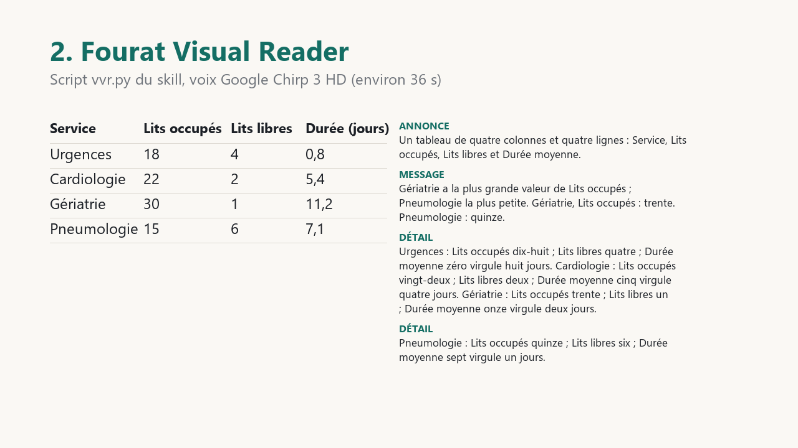

<p align="center"></p>

# Fourat Visual Reader

**An Agent Skill that teaches voice agents and text-to-speech pipelines to read tables, charts and diagrams aloud, in a
way a listener can actually follow.** English and French. · [Version française](#version-française)

## What it does

Give it a Markdown or CSV table, a bar, line or pie chart, a Mermaid flowchart, an org chart or a photo of a figure, and
ask for it to be spoken. Instead of a cell-by-cell dump, the agent says **what the figure is** (type, size, what it
counts), **what it says** (the one-sentence message), **the few numbers that carry it**, then **offers the rest** and
reads detail on request. Every number, unit, date and symbol is written as words in the target language, so the
text-to-speech engine cannot stumble on "1,234.5 km/h" or "0,50 M€".

It ships as one folder in the open [Agent Skills](https://agentskills.io/specification) format (`SKILL.md` + eight short
references) and an optional Python script with no dependency that narrates, writes SSML, and checks that every spoken
number exists in the source.

## Why

A listener hears once, at a fixed speed, cannot glance back, and holds about four items in mind. That is the situation
of a blind or low-vision person using a screen reader, of someone on the phone with a voice agent, of a driver asking
for a report, of anyone listening to a note instead of reading it. Charts and tables were designed for eyes; read
literally, they become a stream of numbers nobody can follow. Research on blind readers (see
[`research/STATE_OF_THE_ART.md`](research/STATE_OF_THE_ART.md)) says what they want: the structure first, the main
trend, the key values, and the freedom to ask for more. No open skill encoded that for language-model agents, in
English and French, with the number rules each language needs. This one does.

## Before / after

Same model (Claude Sonnet), same small table of four French cities, same instruction "read this aloud for a listener".

| Without the skill | With the skill |
|---|---|
| Voici quatre villes. Bordeaux compte **0,26** million d'habitants sur **49** kilomètres carrés. Nantes, **0,32** million sur **65** kilomètres carrés. Lille, **0,24** million sur **35** kilomètres carrés. Et Toulouse, **0,50** million sur **118** kilomètres carrés. | Un tableau de trois colonnes et quatre lignes, une ligne par ville : population en millions, et superficie en kilomètres carrés. **Toulouse est la plus peuplée et la plus étendue ; Lille est la plus petite.** Bordeaux : population zéro virgule vingt-six million ; superficie quarante-neuf kilomètres carrés. Nantes : zéro virgule trente-deux million ; soixante-cinq kilomètres carrés. Lille : zéro virgule vingt-quatre million ; trente-cinq kilomètres carrés. Toulouse : zéro virgule cinq million ; cent dix-huit kilomètres carrés. |

Measured on 34 cases (17 English, 17 French), details in [`eval/RESULTS.md`](eval/RESULTS.md):

- **Pronounceable text**: from 14 problems per 100 words (bare digits, symbols, abbreviations) to **zero** in all 34 texts.
- **Structure first**: 41 % → **91 %** of texts open with the type, a size and what it counts.
- **Offer of detail** on every medium and large table (50 % → 100 %).
- **No information lost**: a blind judge answers 99 % of questions from the skill text, 98 % from the plain text
  (no significant difference). Honest cost: texts are about 40 % longer.

**Announce → Message → Key figures → Offer → Detail on demand.** Short sentences, one number per sentence, groups of
three, numbers and units written as words in the target language, interpretation only when asked, and never a number
that is not in the data.

## Comparison with ChatGPT read-aloud

One fictional French table, two readings: the ChatGPT mobile app's "Read aloud" button on the answer containing the
table, then this skill's script with a Google Chirp 3 HD voice. 66-second video, audio only for ChatGPT (no screen
captured), recorded on 2 November 2026.

<p align="center"><a href="docs/comparison/chatgpt-vs-fourat.mp4"></a></p>

| Service | Lits occupés | Lits libres | Durée moyenne (jours) |
|---|---|---|---|
| Urgences | 18 | 4 | 0,8 |
| Cardiologie | 22 | 2 | 5,4 |
| Gériatrie | 30 | 1 | 11,2 |
| Pneumologie | 15 | 6 | 7,1 |

If the video does not play in your browser, the audio alone:
[ChatGPT read-aloud (15 s)](docs/comparison/audio-chatgpt.mp3) ·
[Fourat Visual Reader (36 s)](docs/comparison/audio-fourat-visual-reader.mp3) ·
[full track with the title and closing slides (66 s)](docs/comparison/audio-full-comparison.mp3).

What the skill's reading does on this table: it announces the shape first (four columns, four rows), gives the key
point (most and fewest occupied beds), then reads each row, every number in words and none absent from the table.
Limits: a single table, different voices, no listeners tested, and the skill's reading is longer (about 36 s versus
14 s). The ChatGPT reading was not transcribed; listen and judge. The recording predates the unit-singular rule of the
current script ("zéro virgule huit jours" is now "jour").

## Install

The skill follows the open [Agent Skills](https://agentskills.io/specification) format: one folder with a `SKILL.md`.

- **Claude Code / Claude.ai**: copy `skills/fourat-visual-reader/` into your skills directory (for example
  `~/.claude/skills/`).
- **Other agents** (Codex, Cursor, custom LLM pipelines): give the model the content of `SKILL.md` when the output will be
  spoken; load the `references/` files it points to as needed. No dependency.

## Use

Ask anything that ends up spoken: "read me this table", "describe this chart for a voice note", "lis-moi ce tableau",
"écris le SSML de ce graphique". The skill triggers on voice, TTS, screen-reader, phone or SSML contexts.

The optional helper script needs only Python 3.9+ (standard library):

```bash
python skills/fourat-visual-reader/scripts/vvr.py speak table.md --lang fr          # spoken text
python skills/fourat-visual-reader/scripts/vvr.py speak flow.mmd --kind flowchart --ssml
python skills/fourat-visual-reader/scripts/vvr.py verify ir.json spoken.txt --lang en  # numbers not in the data
python skills/fourat-visual-reader/scripts/vvr.py lint spoken.txt                     # digits, symbols, abbreviations
python skills/fourat-visual-reader/scripts/vvr.py selftest
```

It parses Markdown/CSV tables and Mermaid flowcharts, narrates tables, bar/line/pie charts and flowcharts in English or
French, writes SSML, and checks that every spoken number exists in the source.

### Example

Input:

| City | Population (millions) | Area (km²) |
|---|---|---|
| Paris | 2.1 | 105 |
| Lyon | 0.5 | 48 |
| Marseille | 0.9 | 241 |

Output of `vvr.py speak --lang en` (verbatim, `eval/outputs/script/en_table_small.txt`):

> A table with three columns and three rows: City, Population and Area.
>
> Paris has the largest Population; Lyon the smallest. Paris, Population: two point one million. Lyon: zero point five
> million.
>
> Paris: Population two point one million; Area one hundred five square kilometres. Lyon: Population zero point five
> million; Area forty-eight square kilometres. Marseille: Population zero point nine million; Area two hundred forty-one
> square kilometres.

The hand-written version in `references/examples.md` is shorter (announce, message, rows); the script adds the key-figures
block because it cannot judge when the message alone carries the point.

## What is in the repository

| Path | Content |
|---|---|
| `skills/fourat-visual-reader/SKILL.md` | the method, under 150 lines |
| `skills/fourat-visual-reader/references/` | tables, charts, diagrams, numbers (en, fr), SSML per engine, dialogue commands, worked examples |
| `skills/fourat-visual-reader/scripts/vvr.py` | parser, narrator, SSML, number verifier, lint, self-test |
| `research/STATE_OF_THE_ART.md` | what exists (skills, repos, accessibility guidelines, research, TTS/SSML), every claim with a URL and licence; what is missing |
| `research/DESIGN.md` | the design, each rule marked sourced / practice / untested |
| `eval/` | pre-registered protocol, 34 cases (17 en, 17 fr) with expected answers, three arms (no skill, with skill, script), judge, metrics, `RESULTS.md` |

## Evidence and limits

Results of the controlled comparison are in [`eval/RESULTS.md`](eval/RESULTS.md). Read them with these limits in mind:
the judge is a language model reading the text, not a person listening; the evidence base in the literature is small
(studies of 6 to 30 blind readers, desktop screen readers, English); the bias-list and number rules for French follow
metropolitan usage (say "virgule"), Quebec usage differs. The script reads a unitless column as "header, value"
("Free beds: one") and cannot turn it into a counted noun phrase ("one free bed", "une chambre libre"), because that
needs the noun's number and, in French, its gender; the skill's prose templates leave that to the model. Nothing here
was tested with real listeners yet; that is the next step and contributions are welcome
([CONTRIBUTING.md](CONTRIBUTING.md)).

## Licence

MIT. Ideas from the accessibility and visualisation research are cited in `research/`; no text was copied from
copyleft or unlicensed sources.

---

# Version française

**Un skill d'agent qui apprend aux agents vocaux et aux synthèses vocales à lire un tableau, un graphique ou un schéma
de manière compréhensible à l'oreille.** Anglais et français.

## Ce qu'il fait

Donnez-lui un tableau Markdown ou CSV, un graphique en barres, en courbes ou un camembert, un diagramme de flux Mermaid,
un organigramme ou la photo d'une figure, et demandez qu'il soit lu. Au lieu de déverser les cellules, l'agent dit **ce
qu'est la figure** (type, taille, ce qu'elle compte), **ce qu'elle dit** (le message en une phrase), **les quelques
chiffres qui le portent**, puis **offre la suite** et lit le détail à la demande. Chaque nombre, unité, date et symbole
est écrit en mots dans la langue cible : la synthèse vocale ne bute plus sur « 1 234,5 km/h » ni sur « 0,50 M€ ».

Il se présente comme un dossier au format ouvert [Agent Skills](https://agentskills.io/specification) (`SKILL.md` et
huit courtes références) et un script Python optionnel, sans dépendance, qui narre, écrit du SSML et vérifie que chaque
nombre prononcé existe dans la source.

## Pourquoi

Un auditeur entend une fois, à vitesse fixe, ne peut pas revenir en arrière, et retient environ quatre éléments. C'est la
situation d'une personne aveugle ou malvoyante avec un lecteur d'écran, de quelqu'un au téléphone avec un agent vocal,
d'un conducteur qui demande un rapport, de quiconque écoute une note au lieu de la lire. Tableaux et graphiques ont été
conçus pour les yeux ; lus mot à mot, ils deviennent un flot de nombres que personne ne suit. La recherche auprès de
lecteurs aveugles (voir [`research/STATE_OF_THE_ART.md`](research/STATE_OF_THE_ART.md)) dit ce qu'ils attendent : la
structure d'abord, la tendance principale, les valeurs clés, et la liberté d'en demander plus. Aucun skill ouvert ne
codait cela pour les agents à modèle de langue, en français et en anglais, avec les règles de nombres propres à chaque
langue. Celui-ci le fait.

## Avant / après

Même modèle (Claude Sonnet), même petit tableau de quatre villes, même consigne « lis ceci à voix haute pour un
auditeur » : l'exemple est dans la section anglaise ci-dessus. Mesuré sur 34 cas (17 anglais, 17 français), détails dans
[`eval/RESULTS.md`](eval/RESULTS.md) :

- **Texte prononçable** : de 14 problèmes pour 100 mots (chiffres bruts, symboles, abréviations) à **zéro** sur les 34 textes.
- **Structure d'abord** : 41 % → **91 %** des textes commencent par le type, une taille et ce qu'elle compte.
- **Offre de détail** sur tous les tableaux moyens et grands (50 % → 100 %).
- **Aucune information perdue** : un juge aveugle répond à 99 % des questions depuis le texte avec skill, 98 % depuis le
  texte sans (différence non significative). Coût assumé : des textes environ 40 % plus longs.

**Annoncer → Message → Chiffres clés → Offrir → Détail à la demande.** Phrases courtes, un nombre par phrase, blocs de
trois, nombres et unités écrits en mots dans la langue cible, interprétation seulement sur demande, et jamais un nombre
absent des données.

## Comparatif avec la lecture à voix haute de ChatGPT

Un tableau fictif en français, deux lectures : le bouton « Lire à voix haute » de l'application mobile ChatGPT sur la
réponse qui contient le tableau, puis le script de ce skill avec une voix Google Chirp 3 HD. Vidéo de 66 secondes,
son seul pour ChatGPT (aucun écran capturé), enregistrements du 2 novembre 2026.

<p align="center"><a href="docs/comparison/chatgpt-vs-fourat.mp4"></a></p>

| Service | Lits occupés | Lits libres | Durée moyenne (jours) |
|---|---|---|---|
| Urgences | 18 | 4 | 0,8 |
| Cardiologie | 22 | 2 | 5,4 |
| Gériatrie | 30 | 1 | 11,2 |
| Pneumologie | 15 | 6 | 7,1 |

Si la vidéo ne se lit pas dans votre navigateur, le son seul :
[lecture ChatGPT (15 s)](docs/comparison/audio-chatgpt.mp3) ·
[Fourat Visual Reader (36 s)](docs/comparison/audio-fourat-visual-reader.mp3) ·
[piste complète avec les diapositives de titre et de fin (66 s)](docs/comparison/audio-full-comparison.mp3).

Ce que fait la lecture du skill sur ce tableau : elle annonce d'abord la forme (quatre colonnes, quatre lignes), donne
le point clé (le plus et le moins de lits occupés), puis lit chaque ligne, tous les nombres en toutes lettres et aucun
absent du tableau. Limites : un seul tableau, des voix différentes, pas d'auditeurs testés, et une lecture plus longue
(environ 36 s contre 14 s). La lecture de ChatGPT n'a pas été transcrite : écoutez et jugez. L'enregistrement précède
la règle du singulier des unités du script actuel (« zéro virgule huit jours » se dit désormais « jour »).

## Installation

Le skill suit le format ouvert [Agent Skills](https://agentskills.io/specification) : un dossier avec un `SKILL.md`.

- **Claude Code / Claude.ai** : copier `skills/fourat-visual-reader/` dans le dossier des skills (par exemple
  `~/.claude/skills/`).
- **Autres agents** (Codex, Cursor, pipelines maison) : donner au modèle le contenu de `SKILL.md` quand la sortie sera
  parlée ; charger les fichiers de `references/` qu'il indique selon le besoin. Aucune dépendance.

## Utilisation

Toute demande dont la sortie sera entendue : « lis-moi ce tableau », « décris ce graphique pour une note vocale », « écris
le SSML de ce graphique ». Le skill se déclenche dans les contextes voix, synthèse vocale, lecteur d'écran, téléphone, SSML.

Le script d'aide, optionnel, ne demande que Python 3.9+ (bibliothèque standard) ; voir les commandes ci-dessus. Il analyse
les tableaux Markdown/CSV et les diagrammes de flux Mermaid, narre tableaux, barres, courbes, camemberts et flux en
français ou en anglais, écrit du SSML, et vérifie que chaque nombre prononcé existe dans la source.

## Preuves et limites

Les résultats de la comparaison contrôlée sont dans [`eval/RESULTS.md`](eval/RESULTS.md). À lire avec ces limites : le
juge est un modèle de langue qui lit le texte, pas une personne qui écoute ; la littérature repose sur de petites études
(6 à 30 lecteurs aveugles, lecteurs d'écran de bureau, anglais) ; les règles de nombres en français suivent l'usage
métropolitain (dire « virgule »), l'usage québécois diffère. Le script lit une colonne sans unité sous la forme
« en-tête, valeur » (« Lits libres : un ») et ne sait pas en faire un groupe nominal compté (« un lit libre », « une
chambre libre »), ce qui demande le nombre et le genre du nom ; les gabarits du skill laissent ce choix au modèle. Rien
n'a encore été testé avec de vrais auditeurs : c'est la prochaine étape, et les contributions sont bienvenues
([CONTRIBUTING.md](CONTRIBUTING.md)).

## Licence

MIT. Les idées issues de la recherche en accessibilité et en visualisation sont citées dans `research/` ; aucun texte
n'a été copié de sources copyleft ou sans licence.
